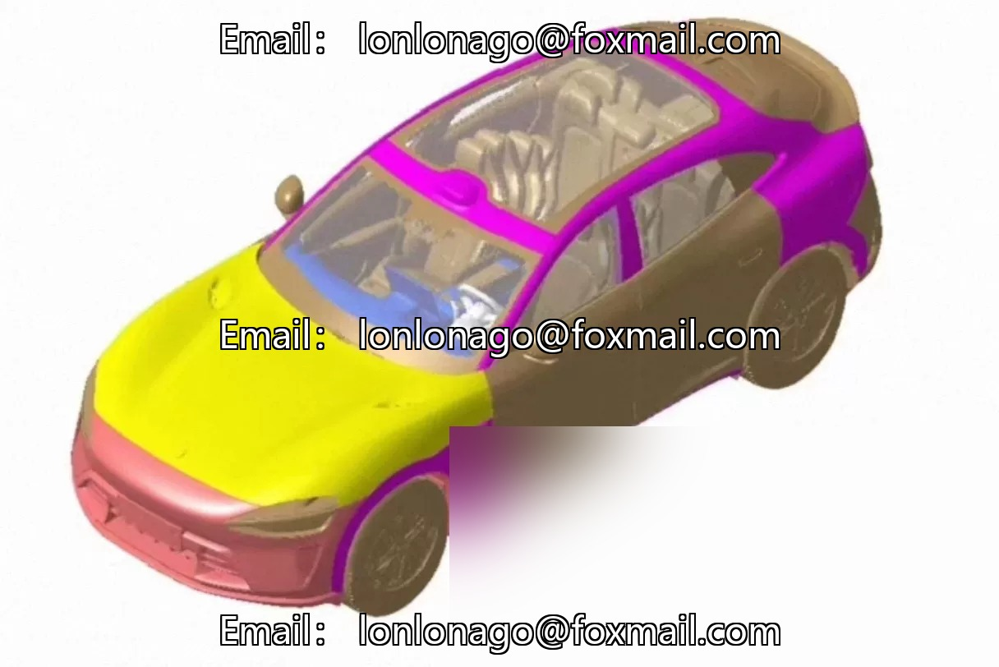
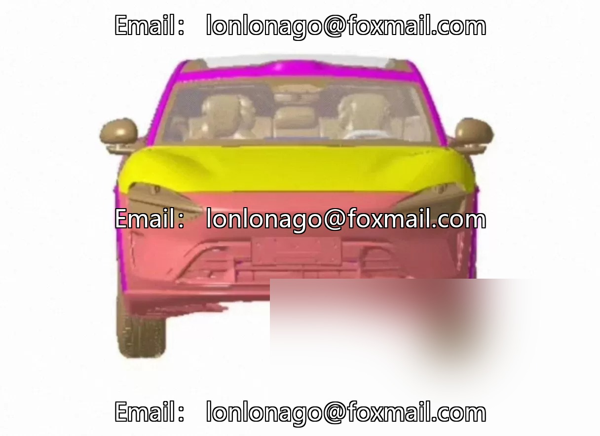
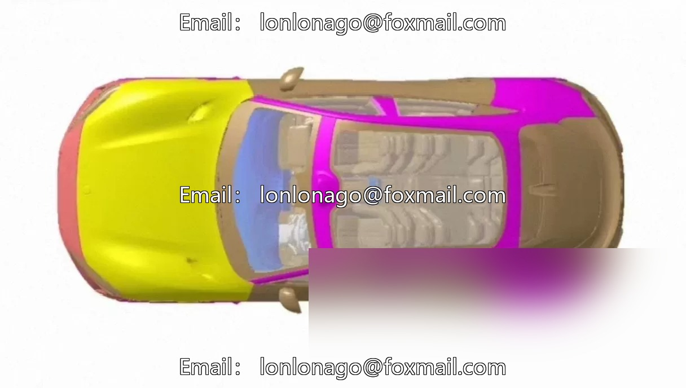
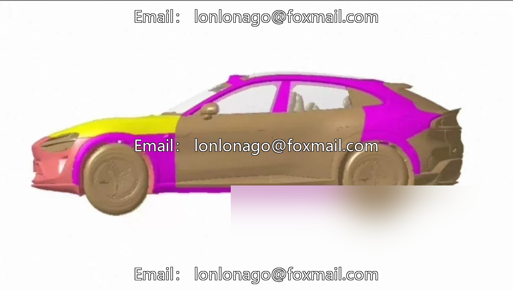
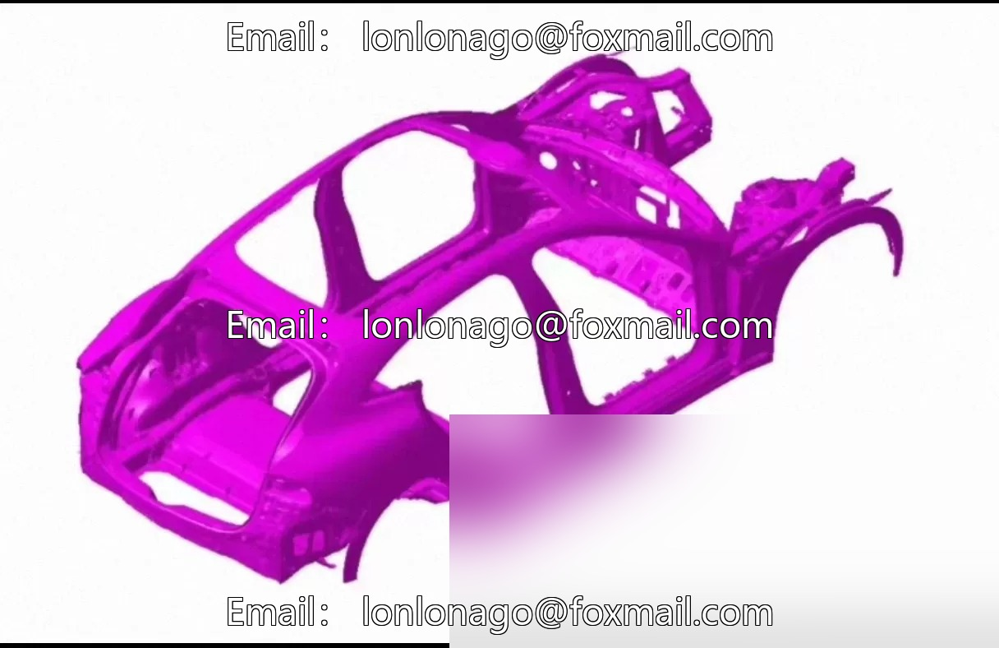
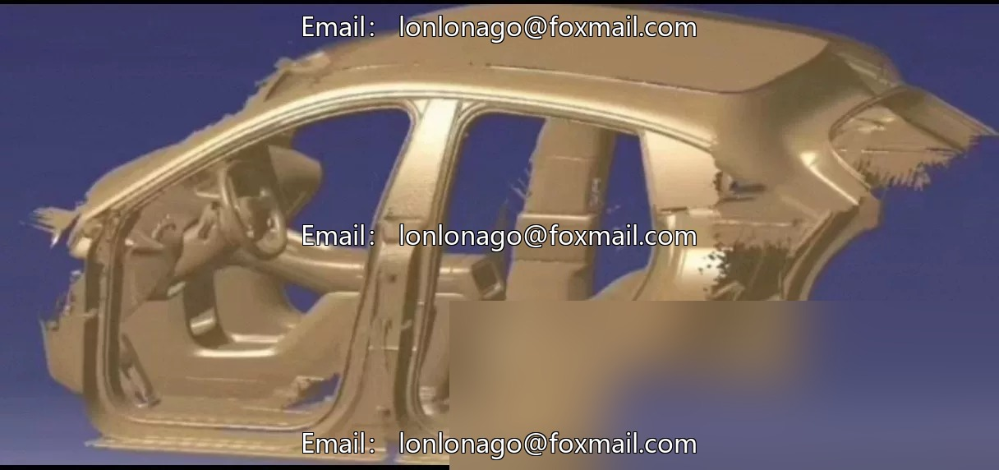

# Xiaomi YU7 2025 model automotive scanning data car total layout point cloud STL format

## Body

Xiaomi YU7 2025 model automobile scan data, automotive total layout point cloud STL format, including human and machine hard points

Automotive real vehicle scanning data Real vehicle one-to-one scan Full vehicle true dimensions Computer model is not physical object. Format is STL Useable for total layout and human-machine benchmarking use as well as for the development and use of automobile modification supplies. The product is of replicable nature and is non-refundable upon sale.

The scan data includes automobile total layout point clouds, STL format with human-machine hard points, suitable for total layout comparison, human-matching, and automotive modification development.

<!-- AI_ENRICHED -->

## Images

## Payment

Here is a pay link on Stripe ( https://buy.stripe.com/3cs8yP7sY87d0vu9AB ). Please contact me lonlonago@foxmail.com after funding $89, and I will send you a complete data files , thank you!

